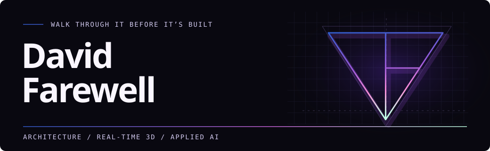

## Walk through it before it’s built.

A competition image that makes you stop scrolling. A home you can explore before the first brick goes down. A different version of the same space, ready while the design is still up for debate.

I’m **David Farewell**, an architect working across **cinematic visualization, real-time 3D, and applied AI**. I create architectural imagery, build interactive walkthroughs, and prototype ways to explore more visual directions before committing to one. I also build automations for the repetitive parts of production, so there’s more time to get the shot right.
